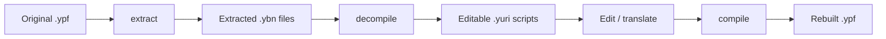
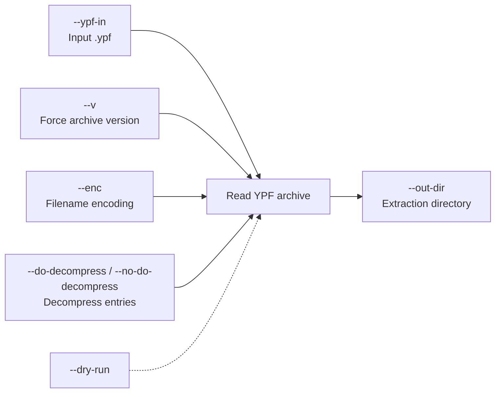
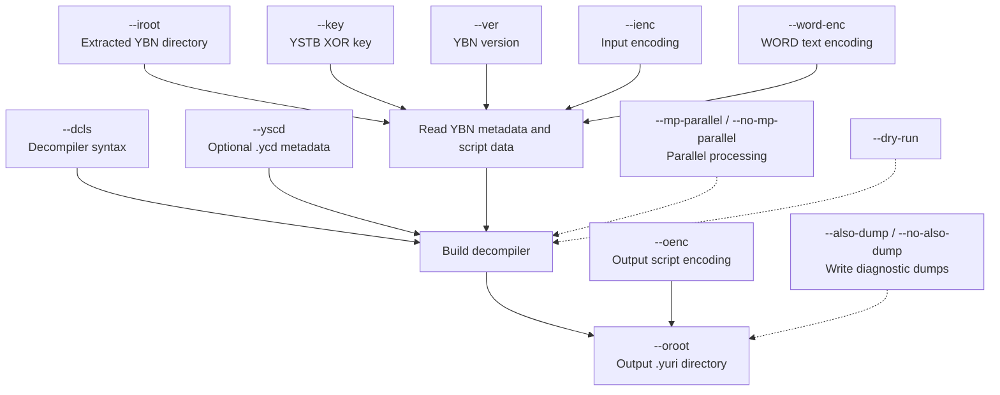
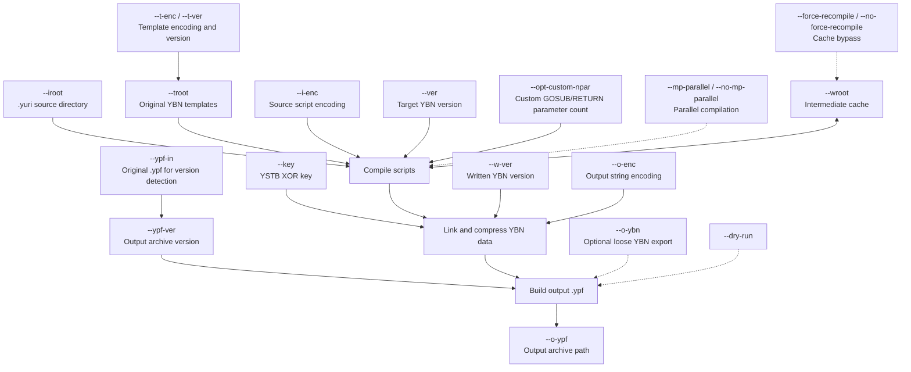
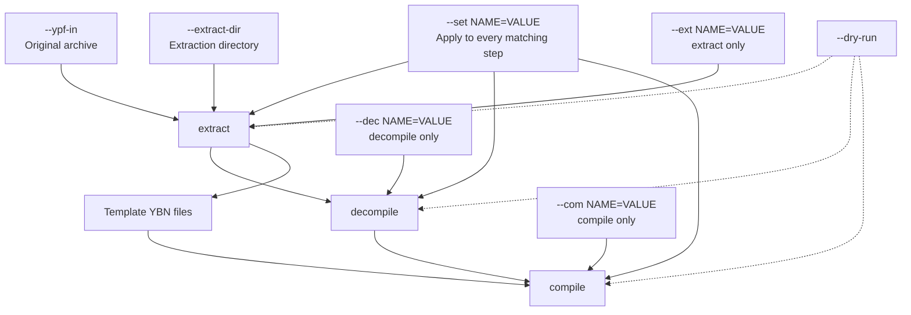

# Yuri CLI

A command-line interface for extracting, decompiling, and recompiling Yu-Ris game data. Use each step independently or run the complete workflow with `all`.

The CLI discovers most of its options from the signatures of `ypf_read`, `yuridec.run`, and `yuricom.run`. The parameter maps and tables below document the options exposed by the current implementation.

## Summary

- [Installation](#installation)
- [The workflow](#the-workflow)
- [Quick start](#quick-start)
- [How options work](#how-options-work)
- [Command parameter maps](#command-parameter-maps)
  - [`extract`](#extract)
  - [`decompile`](#decompile)
  - [`compile`](#compile)
  - [`all`](#all)
- [Parameters not exposed as CLI options](#parameters-not-exposed-as-cli-options)
- [Dry run](#dry-run)
- [Common issues](#common-issues)

## Installation

### Requirements

- **Python 3.13.x**. The project currently targets Python 3.13 and does not support Python 3.12 or 3.14.
- The project source, including `pyproject.toml`.

### 1. Install Yuri and its dependencies

```bash
python -m pip install --upgrade pip
python -m pip install .
```

The dependencies (`murmurhash2`, `xor-cipher`, and `deflate`) are declared in `pyproject.toml`; there is no need to install them separately.

For development, use an editable installation instead:

```bash
python -m pip install -e .
```

An editable installation makes changes to the local source package available without reinstalling it. Both installation methods work from a local checkout or source archive; neither requires a repository-specific Git URL.

### 2. Check the installation

After installation, check that the command is available:

```bash
yuri --help
```

You can also launch the CLI as a Python module, without using the installed entry point:

```bash
python -m yuri.cli --help
```

To see the options of a particular command:

```bash
yuri extract --help
yuri decompile --help
yuri compile --help
yuri all --help
```

> **Tip:** the CLI can be launched from any directory after installation, but relative paths are resolved against the current working directory. Run it from the directory where you want the `ypf/` and `ybn/` working folders to be created. Running it from the project root matches the example paths below.

## The workflow

| Command | Purpose |
|---|---|
| `extract` | Extracts the files stored inside the original `.ypf` archive. |
| `decompile` | Converts extracted `.ybn` script data into editable `.yuri` files. |
| `compile` | Compiles edited `.yuri` files and packages the generated data into a new `.ypf`. |
| `all` | Runs `extract`, `decompile`, and `compile` in sequence. |



## Quick start

Create the input folder and place the game's original archive at `ypf/ysbin-input.ypf`:

```text
your-working-folder/
└── ypf/
    └── ysbin-input.ypf
```

Then, from `your-working-folder`, run:

```bash
yuri all
```

With the example defaults in `yuri/cli/defaults.py`, the main directories are:

```text
your-working-folder/
├── ypf/
│   ├── ysbin-input.ypf             <- original archive (input)
│   └── ysbin-output.ypf            <- rebuilt archive (output)
└── ybn/
    ├── original/ysbin/*.ybn        <- extracted files and compiler templates
    ├── decoded/unofficial/*.yuri   <- decompiled scripts (edit these)
    └── encoded/temp/               <- compilation cache
```

For a typical translation workflow, extract and decompile once, edit the generated `.yuri` files, and run `compile` whenever you need a new archive:

```bash
yuri extract
yuri decompile
# Edit the .yuri files.
yuri compile
```

## How options work

- A core parameter named `some_value` becomes `--some-value`.
- Boolean options have both forms: `--mp-parallel` enables the option and `--no-mp-parallel` disables it.
- Integer options accept decimal and hexadecimal notation, such as `480` and `0x1E0`.
- `COMMAND --help` shows the options and defaults generated by the running code. It is the definitive reference if the core implementation changes.
- Every command accepts `--dry-run`, which prints the call that would be made without performing the requested operation.

### How defaults are resolved

For each supported parameter, the CLI uses the first applicable value in this order:

1. The value supplied on the command line.
2. The game-specific value in `yuri/cli/defaults.py`.
3. The parameter's default in the core function.
4. If there is no default, the CLI reports the parameter as required.

The defaults in `yuri/cli/defaults.py` mirror the example setup in `main.py` and are tailored to **Unionism Quartet**. A different game will usually need different values for the YBN version and YSTB XOR key.

---

# Command parameter maps

The diagrams show how each available option influences the command. The tables underneath describe each option and its default.

## `extract`

Reads the original `.ypf` archive and writes its entries to a directory.

### Parameter map



### Options

| Option | Description | Default |
|---|---|---|
| `--ypf-in PATH` | Original `.ypf` archive to read. | `ypf/ysbin-input.ypf` |
| `--out-dir DIR` | Directory where archive entries are written. | `ybn/original` |
| `--v VERSION` | Overrides the version read from the YPF header. Usually leave unset so the version is detected from the file. | Core default: `None` |
| `--enc ENCODING` | Encoding used to decode file names stored in the archive. | Core default: `cp932` |
| `--do-decompress` / `--no-do-decompress` | Controls whether compressed entries are decompressed during extraction. | Enabled |
| `--dry-run` | Prints the `ypf_read` call and destination without extracting entries. | Off |

Example:

```bash
yuri extract \
    --ypf-in game/ysbin.ypf \
    --out-dir work/original \
    --enc cp932
```

The CLI opens the archive itself, so the file-handle parameter of `ypf_read` is not exposed as an option.

## `decompile`

Reads the extracted YBN files and produces editable scripts. Its input directory must contain the YBN metadata files and the script data files from the archive.

### Parameter map



### Options

| Option | Description | Default |
|---|---|---|
| `--iroot DIR` | Directory containing extracted `.ybn` files (`ysc.ybn`, `ysv.ybn`, `ysl.ybn`, `yst_list.ybn`, and numbered `yst*.ybn` files). | `ybn/original/ysbin` |
| `--oroot DIR` | Destination for generated `.yuri` files and optional dump files. | `ybn/decoded/unofficial` |
| `--ienc ENCODING` | Encoding used when reading strings from input YBN data. | `cp932` |
| `--oenc ENCODING` | Encoding used when writing generated `.yuri` scripts and dumps. | `utf-8` |
| `--yscd FILE` | Loads an official compiler `.ycd` file to provide command/variable metadata. Pass the file path. | Unset |
| `--dcls CLASS` | Selects the output syntax/decompiler implementation: `YDecYuri` for Yuri's custom syntax or `YDecYuris` for the official-style syntax. | `YDecYuri` |
| `--mp-parallel` / `--no-mp-parallel` | Enables or disables multiprocessing while processing scripts. | Disabled |
| `--also-dump` / `--no-also-dump` | Writes additional `.dump` files for script commands and metadata. | Enabled |
| `--key INTEGER` | XOR key used to decode YSTB script data. The correct key is game-specific. | `0x9C28430C` |
| `--ver VERSION` | YBN/YSTB format version used while reading the game's data. This is not necessarily the version reported by the YPF archive or executable. | `480` |
| `--word-enc ENCODING` | Optional encoding override for `WORD` command text. When omitted, it falls back to `--ienc`. | Unset (uses `--ienc`) |
| `--dry-run` | Prints the decompiler call without generating files. | Off |

Example using a different input folder and key:

```bash
yuri decompile \
    --iroot work/original/ysbin \
    --oroot work/scripts \
    --key 0x1234ABCD \
    --ver 500
```

To use the official-style syntax with a matching `.ycd` file:

```bash
yuri decompile \
    --dcls YDecYuris \
    --yscd YSCom/<ypf-version>.ycd \
    --oroot ybn/decoded/official \
    --oenc cp932 \
    --no-also-dump \
    --ver <ybn-version>
```

## `compile`

Compiles the edited `.yuri` files, uses the original YBN metadata files as templates, and creates a new `.ypf` archive.

### Parameter map



### Options

| Option | Description | Default |
|---|---|---|
| `--key INTEGER` | XOR key used when linking/encoding generated YSTB data. It must match the target game. | `0x9C28430C` |
| `--iroot DIR` | Directory containing `.yuri` source files to compile. | `ybn/decoded/unofficial` |
| `--ver VERSION` | Target YBN/compiler format version used to compile scripts. | `480` |
| `--wroot DIR` | Directory for intermediate compilation and link/compression cache files. | `ybn/encoded/temp` |
| `--troot DIR` | Directory containing original YBN templates, including `ysv.ybn`, `ysc.ybn`, `yse.ybn`, and `yscfg.ybn`. | `ybn/original/ysbin` |
| `--o-ypf FILE` | Path of the rebuilt `.ypf` archive. | `ypf/ysbin-output.ypf` |
| `--o-ybn DIR` | Additionally exports generated YBN entries as loose files under this directory. The `.ypf` is still generated. | Unset |
| `--i-enc ENCODING` | Encoding used to read `.yuri` source files. | `utf-8` |
| `--t-enc ENCODING` | Encoding used to read original template files in `--troot`. | Core default: `cp932` |
| `--t-ver VERSION` | Version used to parse original template files in `--troot`. | `480` |
| `--w-ver VERSION` | Version written into generated YBN files. | `554` |
| `--o-enc ENCODING` | Encoding used for strings written into generated YBN data. | `cp932` |
| `--mp-parallel` / `--no-mp-parallel` | Enables or disables multiprocessing during compilation and linking/compression. | Disabled |
| `--force-recompile` / `--no-force-recompile` | Forces recompilation instead of reusing valid intermediate cache entries in `--wroot`. | Disabled |
| `--ypf-ver VERSION` | Version written to the new YPF header. When omitted, the CLI tries to read it from `--ypf-in`. | Detected from `ypf/ysbin-input.ypf` when available |
| `--ypf-in FILE` | Original `.ypf` used only to detect the version for the new archive. The YBN templates still come from `--troot`. | `ypf/ysbin-input.ypf` |
| `--opt-custom-npar` / `--no-opt-custom-npar` | Enables the custom `GOSUB`/`RETURN` parameter-count encoding (`GOSUB_NPAR`) for games that require it. | Disabled |
| `--dry-run` | Prints the compiler call without compiling or packaging the output. | Off |

There are three separate YBN version controls:

- `--ver`: version used to compile the scripts.
- `--t-ver`: version used to read the original template YBN files.
- `--w-ver`: version written into the generated YBN files.

`--ypf-ver` is separate: it controls the header of the final `.ypf`. By default, the CLI detects this version from `--ypf-in`. If the input archive cannot be read, pass `--ypf-ver` explicitly when the fallback core default is not suitable.

Example:

```bash
yuri compile \
    --iroot work/scripts \
    --troot work/original/ysbin \
    --o-ypf output/translated.ypf \
    --o-ybn output/ysbin \
    --w-ver 554
```

Compilation is incremental. Valid cached results in `--wroot` are reused unless `--force-recompile` is enabled.

## `all`

Runs `extract`, `decompile`, and `compile` in sequence. Since the individual steps share parameter names, `all` uses repeatable `NAME=VALUE` overrides instead of exposing every core option directly.

### Parameter map



### Options

| Option | Description |
|---|---|
| `--ypf-in FILE` | Original `.ypf` archive used by extraction and to detect the output YPF version. |
| `--extract-dir DIR` | Directory where archive entries are extracted. It also adjusts the default decompiler input and compiler template directory to `<DIR>/ysbin`. |
| `--set NAME=VALUE` | Applies an override to every step that exposes the parameter named `NAME`. Repeatable. |
| `--ext NAME=VALUE` | Applies an override only to `extract`. Repeatable. |
| `--dec NAME=VALUE` | Applies an override only to `decompile`. Repeatable. |
| `--com NAME=VALUE` | Applies an override only to `compile`. Repeatable. |
| `--dry-run` | Shows the calls for the three steps without running the workflow. |

The names accepted by `NAME=VALUE` are the same parameter names shown in the `extract`, `decompile`, and `compile` tables. Names may use underscores or hyphens; values are converted according to the parameter type.

A step-specific override (`--ext`, `--dec`, or `--com`) takes precedence over a matching general `--set` override.

Examples:

```bash
# Apply the key to both decompile and compile.
yuri all --set key=0x1234ABCD

# Override only the compiler's output YBN version.
yuri all --com w_ver=600

# Use the official-style decompiler only for the decompile step.
yuri all --dec dcls=YDecYuris

# Override an extraction option.
yuri all --ext enc=cp932

# Change the archive and the root extraction directory.
yuri all --ypf-in another.ypf --extract-dir another/folder
```

## Parameters not exposed as CLI options

The CLI only converts parameter types it knows how to represent as command-line values.

- `extract`: low-level YPF customization parameters such as `nl_map`, `nb_xor`, `h_name`, `h_file`, and `log` are not exposed. The archive reader uses its internal defaults for them.
- `compile`: `cdict` is a Python dictionary and is not exposed as a command-line option. The `ComOpts` dataclass is flattened, so its `opt_custom_npar` field appears as `--opt-custom-npar` rather than an `--opts` object.
- `decompile`: the current parameters of `yuridec.run` have CLI converters, including the `.ycd` file loader used by `--yscd`.

The CLI omits the file-handle parameter of `ypf_read` because it opens `--ypf-in` itself.

## Dry run

Every command accepts `--dry-run`. It prints the call that would be made to the core without executing the requested operation. Use it to inspect resolved values before running a longer job:

```bash
yuri compile --w-ver 600 --dry-run
```

## Common issues

- **`could not import yuri...`**: activate the virtual environment where Yuri was installed, or reinstall from the project root with `python -m pip install .`.
- **`missing required parameters`**: a core parameter has no value or default; pass the indicated option.
- **`ypf_ver not detected` warning**: the original archive could not be read. Pass `--ypf-in` with a valid archive or set `--ypf-ver` explicitly.
- **Decompilation fails for a different game**: verify the YBN version passed to `--ver` and the game's YSTB XOR key. See [the technical breakdown](../../yuri.md).
